# IRMS — System Architecture Document

> **Incident Reporting Management System — Platform Enterprise Apps**
>
> Version: 2.1 | Last Updated: 2026-07-25 (digabung dengan design.md, auth_gap_analysis.md, flowcharts.md)

---

## Daftar Isi

1. [Ringkasan Eksekutif](#1-ringkasan-eksekutif)
2. [Technology Stack](#2-technology-stack)
3. [Arsitektur Sistem (High-Level)](#3-arsitektur-sistem-high-level)
4. [Arsitektur Backend](#4-arsitektur-backend)
5. [Arsitektur Frontend](#5-arsitektur-frontend)
6. [Arsitektur Database](#6-arsitektur-database)
7. [Autentikasi & Otorisasi](#7-autentikasi--otorisasi)
8. [Arsitektur API](#8-arsitektur-api)
9. [Modul Sistem](#9-modul-sistem)
10. [Alur Kerja Incident Report](#10-alur-kerja-incident-report)
11. [Alur Kerja Safety Observation (NCR & JSO)](#11-alur-kerja-safety-observation-ncr--jso)
12. [Caching & Performance](#12-caching--performance)
13. [Arsitektur Infrastruktur & Deployment](#13-arsitektur-infrastruktur--deployment)
14. [Integrasi Eksternal](#14-integrasi-eksternal)
15. [Mobile App](#15-mobile-app)
16. [Metrik & Statistik Proyek](#16-metrik--statistik-proyek)
17. [Keamanan](#17-keamanan)
18. [Roadmap & Future Work](#18-roadmap--future-work)

---

## 1. Ringkasan Eksekutif

IRMS adalah platform manajemen insiden dan keselamatan kerja berbasis web yang dikembangkan oleh **PT KPI Software Development**, mencakup:

- **Incident Report** — Pelaporan insiden, alur review multi-level, tindak lanjut, investigasi, dan closing
- **Safety Observation (NCR & JSO)** — Observasi keselamatan lapangan, Non-Conformance Report, JSO (Job Safety Observation)
- **JSO Master Data** — Konfigurasi kategori, lokasi JSO, leader & member JSO
- **Task Assignment** — Penugasan dan tracking tindak lanjut insiden/observasi
- **Notification System** — Notifikasi real-time via push (FCM/Firebase) dan broadcast
- **Media Management** — Upload foto/lampiran insiden dan observasi
- **Audit Log** — Pencatatan aktivitas seluruh sistem
- **RBAC** — Role-Based Access Control dengan hierarki user dan permission granular
- **Organisasi** — Manajemen divisi, departemen, job title, dan user hierarchy

Sistem dibangun dengan arsitektur **monolithic layered** pada backend dan **Single Page Application (SPA)** pada frontend, terhubung melalui RESTful API.

---

## 2. Technology Stack

### Backend

| Komponen          | Teknologi                                  |
|-------------------|--------------------------------------------|
| Runtime           | Java 17                                    |
| Framework         | Spring Boot 3.5.4                          |
| Build Tool        | Gradle 8.x                                 |
| ORM               | Spring Data JPA / Hibernate                |
| Security          | Spring Security 6 + JWT (jjwt)             |
| Caching           | Spring Cache + Redis                       |
| Push Notification | Firebase Admin SDK (FCM)                   |
| API Documentation | SpringDoc OpenAPI (Swagger UI)             |
| Email             | Spring Mail (JavaMailSender)               |
| Testing           | JUnit 5 + Spring Boot Test                 |
| Boilerplate       | Lombok                                     |
| Mapping           | ModelMapper                                |

### Frontend

| Komponen         | Teknologi                            |
|------------------|--------------------------------------|
| Framework        | React + Vite                         |
| Language         | TypeScript                           |
| Styling          | Tailwind CSS                         |
| HTTP Client      | Axios                                |
| Testing          | Playwright                           |

### Database & Infrastructure

| Komponen         | Teknologi                            |
|------------------|--------------------------------------|
| Database         | PostgreSQL (production)              |
| Cache            | Redis                                |
| Connection Pool  | HikariCP                             |
| Reverse Proxy    | Nginx / Apache                       |
| Containerization | Docker (multi-stage build)           |
| Deployment       | Railway / VPS (AlmaLinux 9)          |
| Process Manager  | systemd                              |

---

## 3. Arsitektur Sistem (High-Level)

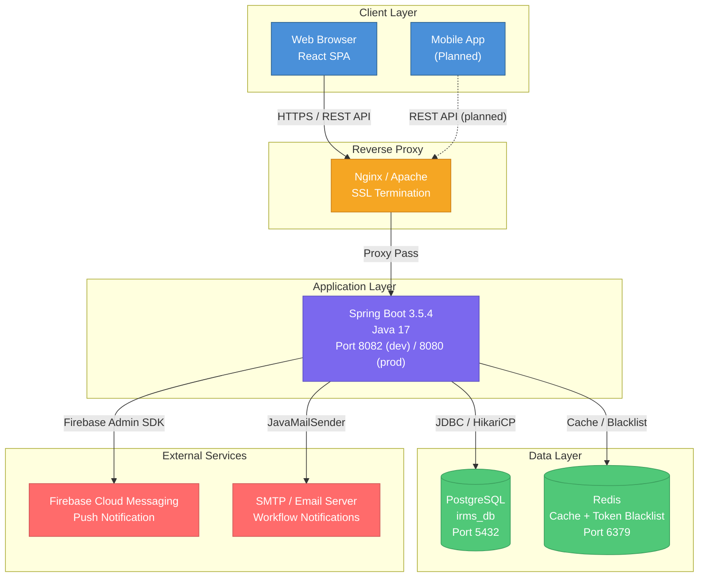

---

## 4. Arsitektur Backend

### Layered Architecture

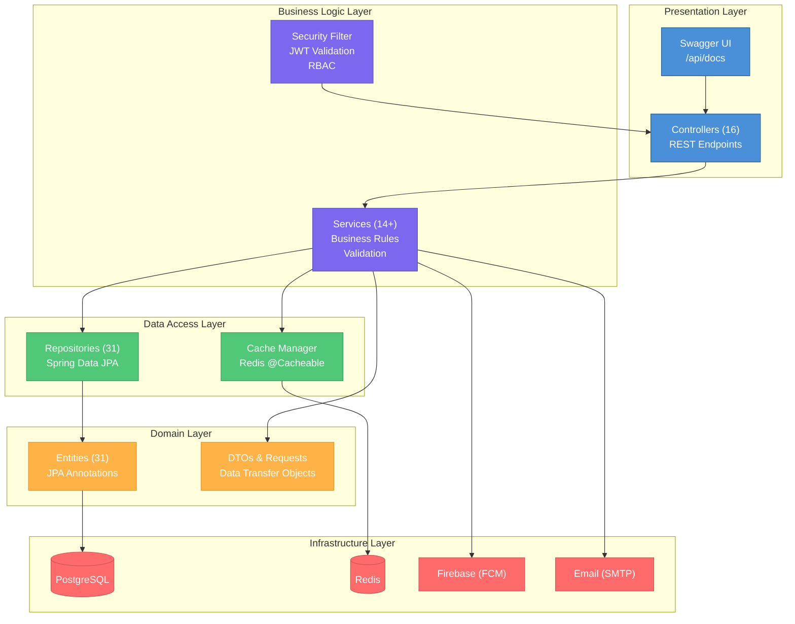

### Package Structure

```
id.enterpriseapps/
├── config/               # 9 kelas konfigurasi
│   ├── AuthenticationConfig.java    # JWT filter chain
│   ├── DataInitializer.java         # Data seed saat startup
│   ├── FirebaseConfig.java          # Firebase Admin SDK
│   ├── OpenApiConfig.java           # SpringDoc / Swagger
│   ├── RedisConfig.java             # Redis cache manager
│   ├── SchemaInitializer.java       # Schema validation
│   ├── SecurityConfig.java          # Spring Security config
│   ├── WebMvcConfig.java            # CORS & MVC config
│   └── CachedBodyHttpServletRequest.java
│
├── controller/           # 16 REST controller
│   ├── AuthController                 # Login, refresh token
│   ├── ProfileController              # Profile pengguna
│   ├── RolePermissionController       # RBAC management
│   ├── IncidentReportController       # Manajemen insiden
│   ├── IncidentTaskController         # Tugas insiden
│   ├── InvestigationDetailController  # Detail investigasi
│   ├── SafetyObservationController    # NCR & JSO
│   ├── JsoReportController            # Laporan JSO
│   ├── ObservationTaskController      # Tugas observasi
│   ├── TaskAssignmentController       # Penugasan umum
│   ├── MasterDataController           # Master data IRMS
│   ├── LookupController               # Data lookup
│   ├── IncidentLookupController       # Lookup khusus insiden
│   ├── NotificationController         # Notifikasi user
│   ├── FcmTokenController             # Registrasi token FCM
│   └── FileUploadController           # Upload foto/lampiran
│
├── entity/               # 31 JPA entity
│   ├── (Core)            UserEntity, RoleEntity, PermissionEntity
│   │                     RolePermissionEntity, UserRoleEntity
│   │                     UserAlertEntity, UserUserAlertEntity
│   │                     FcmTokenEntity, LookupEntity
│   ├── (Organisasi)      DivisionEntity, JobTitleEntity
│   │                     DesignationDepartmentEntity, OriginDepartmentEntity
│   ├── (Insiden)         IncidentReportEntity, IncidentTaskEntity
│   │                     InvestigationDetailEntity
│   │                     AreaIncidentEntity, CategoryIncidentEntity
│   │                     ClassificationIncidentEntity, RegionIncidentEntity
│   │                     RootCauseEntity, LocationEntity, ResultEntity
│   ├── (Safety)          SafetyObservationEntity, JsoReportEntity
│   │                     ObservationTaskEntity, TaskAssignmentEntity
│   │                     JsoLeaderMasterEntity, JsoMemberMasterEntity
│   │                     JsoLocationEntity
│   └── (Keuangan)        ChartOfAccountEntity
│
├── repository/           # 31 Spring Data repository (mirrors entity)
│
├── service/              # 14+ business service
│   ├── auth/             AuthService, ProfileService
│   ├── incident/         IncidentReportService, IncidentTaskService
│   ├── safety/           SafetyObservationService, ObservationTaskService
│   ├── taskassignment/   TaskAssignmentService
│   ├── lookup/           LookupService
│   ├── logging/          LoggingService
│   ├── JwtService, RedisService, NotificationService
│   ├── RolePermissionService, FileUploadService
│   ├── FcmService, EmailService
│   └── WorkflowEmailNotificationService
│
├── request/              # Payload objek request per modul
├── response/             # Wrapper response standar
├── dto/                  # Data Transfer Objects
├── constant/             # Konstanta status, error code
├── utils/                # Utility class
├── validation/           # Custom constraint validator
└── EnterpriseAppsApplication.java # Entry point (@SpringBootApplication + @EnableAsync)
```

---

## 5. Arsitektur Frontend

### SPA Architecture

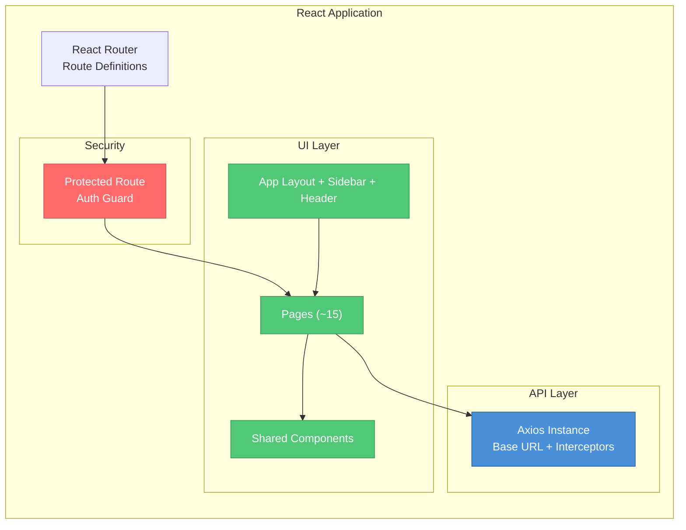

### Frontend Directory Structure (frontend-irms-2)

```
src/
├── pages/
│   ├── Auth/                     # Login, logout
│   ├── Dashboard/                # DashboardPage.tsx
│   ├── Incident Report/
│   │   ├── IncidentReportPage.tsx          # Daftar laporan insiden
│   │   ├── MyIncidentReportPage.tsx        # Laporan milik saya
│   │   ├── HistoryMyIncidentReportPage.tsx # Riwayat laporan saya
│   │   ├── TaskIncidentReportPage.tsx      # Tugas insiden aktif
│   │   └── HistoryTaskIncidentReportPage.tsx
│   ├── SafetyObservation/
│   │   ├── SafetyObservationPage.tsx       # Daftar observasi
│   │   ├── SafetyObservationDetailPage.tsx
│   │   └── CreateSafetyObservationPage.tsx
│   ├── User/
│   │   ├── UserManagementPage.tsx
│   │   ├── ProfileUserPage.tsx
│   │   └── UserAlertsPage.tsx
│   ├── Result/                   # Halaman hasil/output
│   ├── Laboratory/               # Modul laboratorium (LIMS)
│   └── NotFound/
│
└── (components, hooks, api, utils, ...)
```

---

## 6. Arsitektur Database

### Entity-Relationship Overview

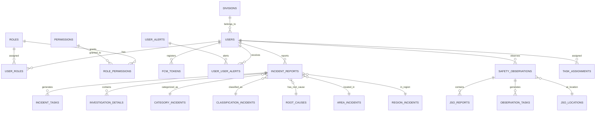

### Tabel Database

#### Core / Users / RBAC (7 tabel)

| Tabel | Deskripsi |
|-------|-----------|
| `users` | Akun pengguna sistem (npp, npk, division, job title) |
| `roles` | Definisi role (SUPER_ADMIN, ADMIN, USER, dll) |
| `permissions` | Definisi permission per modul/aksi |
| `role_permissions` | Mapping role → permission |
| `user_roles` | Mapping user → role |
| `user_alerts` | Template/definisi alert notifikasi |
| `user_user_alerts` | Notifikasi terkirim per user |

#### Organisasi (4 tabel)

| Tabel | Deskripsi |
|-------|-----------|
| `divisions` | Divisi perusahaan |
| `job_titles` | Jabatan/posisi |
| `designation_departments` | Departemen tujuan insiden |
| `origin_departments` | Departemen asal pelapor |

#### Incident Report (9 tabel)

| Tabel | Deskripsi |
|-------|-----------|
| `incident_reports` | Laporan insiden utama |
| `incident_tasks` | Tugas tindak lanjut insiden |
| `investigation_details` | Detail investigasi insiden |
| `category_incidents` | Kategori insiden |
| `classification_incidents` | Klasifikasi tingkat insiden |
| `root_causes` | Akar penyebab insiden |
| `area_incidents` | Area lokasi insiden |
| `region_incidents` | Wilayah/region insiden |
| `locations` | Lokasi detail |

#### Safety Observation / NCR & JSO (7 tabel)

| Tabel | Deskripsi |
|-------|-----------|
| `safety_observations` | Laporan NCR dan JSO |
| `jso_reports` | Detail temuan JSO |
| `observation_tasks` | Tugas tindak lanjut observasi |
| `jso_locations` | Lokasi JSO |
| `jso_leader_masters` | Data leader JSO |
| `jso_member_masters` | Data anggota tim JSO |
| `task_assignments` | Penugasan umum lintas modul |

#### System / Infrastruktur (4 tabel)

| Tabel | Deskripsi |
|-------|-----------|
| `fcm_tokens` | Token FCM untuk push notification |
| `lookup` | Data referensi / master lookup |
| `results` | Data hasil/output sistem |
| `chart_of_accounts` | Bagan akun keuangan (COA) |

### Schema Conventions

- **Primary Key:** `GENERATED ALWAYS AS IDENTITY PRIMARY KEY`
- **Audit Columns:** `created_at`, `created_by`, `updated_at`, `updated_by`
- **Schema Management:** Manual SQL scripts (`ddl-auto: none`)
- **SQL Files:** 25+ migration files di direktori `sql/`

---

## 7. Autentikasi & Otorisasi

### Authentication Flow

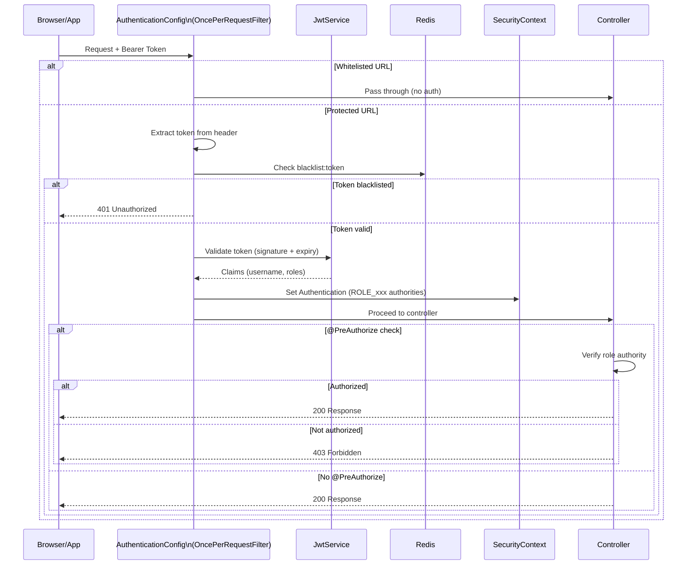

### JWT Configuration

| Parameter | Value |
|-----------|-------|
| Algorithm | HMAC (secret key) |
| Access Token TTL | 15 menit |
| Refresh Token TTL | 7 hari |
| Token Content | username (subject) + roles (claims) |
| Logout Mechanism | Redis blacklist (`blacklist:<token>`) |

### Security Config

| Feature | Setting |
|---------|---------|
| CSRF | Disabled |
| CORS | Configurable origins |
| Session | Stateless (`STATELESS`) |
| Password | BCrypt encoding |
| Method Security | `@EnableMethodSecurity` |
| HSTS | Enabled |
| CSP | `default-src 'self'` |

### Role-Based Access Control (RBAC)

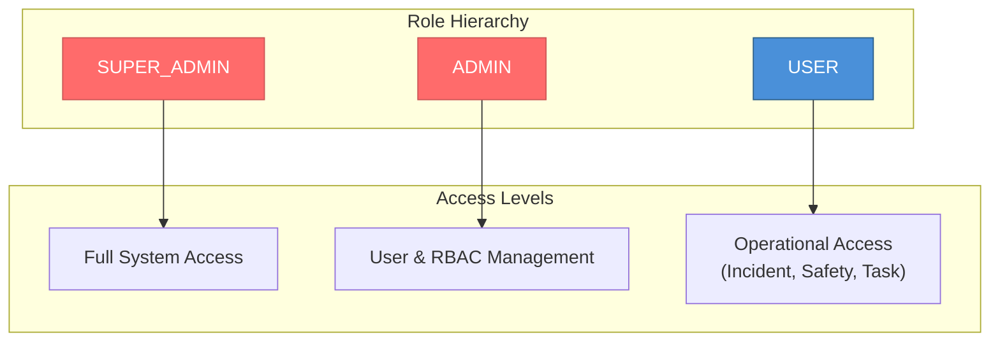

### RBAC Permission Check Flow

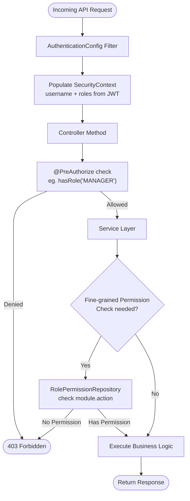

### Whitelisted Endpoints (No Auth)

```
/api/docs/**
/api/v1/auth/login
/api/v1/auth/refresh-token
```

`POST /api/v1/auth/login` dibatasi `LoginThrottleService` (Redis): 5 kegagalan per NPK
dalam 5 menit memicu kunci 15 menit dengan respons `429` + `Retry-After`. Pemeriksaan
terjadi sebelum bind ke AD, sehingga serangan tebak-password tidak ikut mengunci akun
domain korban. Ambang diatur lewat `app.security.login-throttle.*`.

### Known Items / Technical Debt

| Item | Prioritas | Catatan |
| :--- | :--- | :--- |
| ~~Hapus `GET /api/v1/auth/generate-hash`~~ | — | **Selesai.** Endpoint dicabut dari `AuthController` beserta whitelist di `SecurityConfig` dan `AuthenticationConfig`. |
| Lepas `assistant.tools` dari LIMS | Sedang | `assistant.tools.*` (KiPlIAI) menyuntik `lims.service.*` dan memakai `lims.dto.*` — 54 pelanggaran, sehingga `ModuleBoundaryTest` harus mengecualikan paket itu. Selama ini ada, ekstraksi LIMS jadi microservice akan memutus tool KiPlIAI. |
| Rate limiter gateway (Redis) mati | Sedang | Throttle login kini di backend. Rate limit umum per-user di gateway masih nonaktif karena Lua Redis 7+ tidak kompatibel. |
| Eksternalisasi JWT secret | Tinggi | Pastikan `JWT_SECRET` selalu di-override lewat env var di semua environment, bukan default di kode. |
| Whitelist User-Agent hardcoded | Rendah | Saat ini hardcoded di `AuthenticationConfig`; pertimbangkan pindah ke `application.yaml`. |

> Shim re-hash `password123` saat login (dulu tercatat sebagai item usang) **sudah dihapus** dari `AuthService`. Nilai `password123` yang masih muncul di `RolePermissionService` adalah default password yang dipakai admin saat membuat user baru — bukan backdoor.

---

## 8. Arsitektur API

### API Route Groups (16 controller)

| Path | Controller | Deskripsi |
|------|-----------|-----------|
| `/api/v1/auth` | AuthController | Login, refresh token |
| `/api/v1/profile` | ProfileController | Profil pengguna |
| `/api/v1/rbac` | RolePermissionController | Manajemen role & permission |
| `/api/v1/incident-reports` | IncidentReportController | CRUD + workflow insiden |
| `/api/v1/incident-tasks` | IncidentTaskController | Tugas tindak lanjut insiden |
| `/api/v1/investigation-details` | InvestigationDetailController | Detail investigasi insiden |
| `/api/v1/safety-observations` | SafetyObservationController | NCR & JSO |
| `/api/v1/safety-observations/{id}/jso-reports` | JsoReportController | Temuan JSO |
| `/api/v1/observation-tasks` | ObservationTaskController | Tugas tindak lanjut observasi |
| `/api/v1/task-assignments` | TaskAssignmentController | Penugasan lintas modul |
| `/api/v1/master` | MasterDataController | Master data IRMS |
| `/api/v1/lookup` | LookupController | Data lookup |
| `/api/v1/incident-lookup` | IncidentLookupController | Lookup khusus modul insiden |
| `/api/v1/notifications` | NotificationController | Notifikasi user |
| `/api/v1/fcm-tokens` | FcmTokenController | Registrasi token FCM |
| `/api/v1/files` | FileUploadController | Upload & download foto/lampiran |

### API Documentation

- **Swagger UI:** `/api/docs/index.html`
- **OpenAPI JSON:** `/api/docs`
- **Framework:** SpringDoc OpenAPI

---

## 9. Modul Sistem

### Module Map

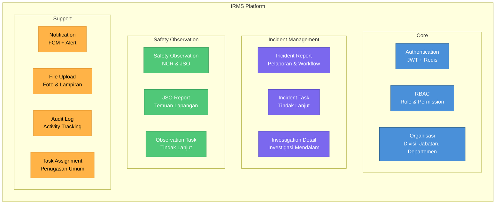

### Detail Modul

| Modul | Entitas Utama | API Path | Deskripsi |
|-------|--------------|----------|-----------|
| **Incident Report** | `incident_reports` | `/api/v1/incident-reports` | Pelaporan insiden + workflow approval |
| **Incident Task** | `incident_tasks` | `/api/v1/incident-tasks` | Tugas tindak lanjut per insiden |
| **Investigation Detail** | `investigation_details` | `/api/v1/investigation-details` | Analisis akar masalah |
| **Safety Observation (NCR)** | `safety_observations` | `/api/v1/safety-observations` | Non-Conformance Report |
| **Safety Observation (JSO)** | `safety_observations` (is_jso=true) | `/api/v1/safety-observations` | Job Safety Observation |
| **JSO Report** | `jso_reports` | `/api/v1/safety-observations/{id}/jso-reports` | Temuan detail per JSO |
| **Observation Task** | `observation_tasks` | `/api/v1/observation-tasks` | Tindak lanjut observasi |
| **Task Assignment** | `task_assignments` | `/api/v1/task-assignments` | Penugasan lintas modul |
| **Notification** | `user_user_alerts`, `fcm_tokens` | `/api/v1/notifications`, `/api/v1/fcm-tokens` | Push + alert notifikasi |
| **File Upload** | — (filesystem) | `/api/v1/files` | Upload foto/lampiran insiden & observasi |
| **Master Data** | 9 tabel master | `/api/v1/master` | Kategori, klasifikasi, area, root cause, dll |
| **RBAC** | `roles`, `permissions` | `/api/v1/rbac` | Manajemen role & permission |

---

## 10. Alur Kerja Incident Report

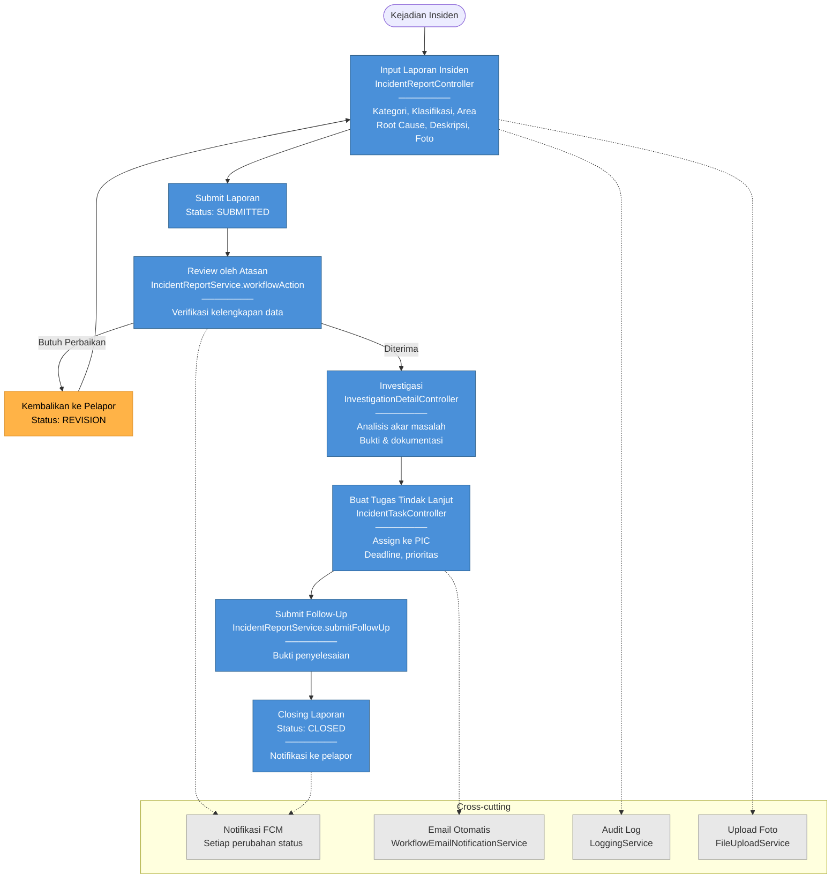

---

## 11. Alur Kerja Safety Observation (NCR & JSO)

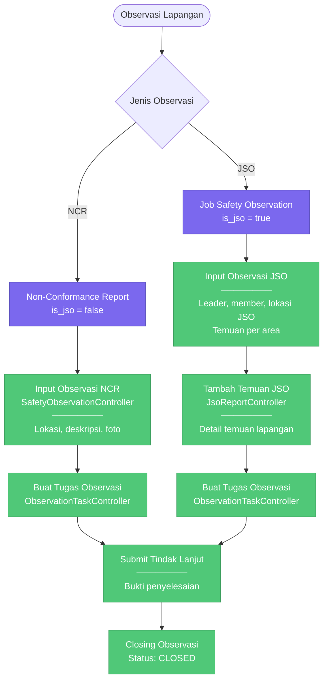

---

## 12. Caching & Performance

### Redis Caching Strategy

| Penggunaan | Key Pattern | TTL |
|-----------|------------|-----|
| Token Blacklist (logout) | `blacklist:<token>` | Umur token tersisa |
| General Cache (`@Cacheable`) | Per method/key | 10 menit |

### Connection Pool (HikariCP)

| Parameter | Value |
|-----------|-------|
| Database | PostgreSQL |
| URL (dev) | `localhost:5432/irms_db` |
| JPA ddl-auto | `none` (manual SQL) |

### Async Processing

Async aktif via `@EnableAsync` di `EnterpriseAppsApplication` — digunakan untuk:
- Pengiriman notifikasi FCM
- Pengiriman email workflow
- Logging aktivitas

---

## 13. Arsitektur Infrastruktur & Deployment

> **Target deploy aktif saat ini:** satu server Ubuntu (192.168.5.105), bukan Kubernetes.
> Server menarik kode dari GitHub dan membangunnya sendiri lewat skrip `baik-deploy`
> (systemd + nginx + Docker untuk RAG). Opsi Docker/Railway/AlmaLinux di bawah ini
> adalah opsi historis/alternatif yang pernah dipertimbangkan — lihat
> [`.claude/skills/deploy/SKILL.md`](../.claude/skills/deploy/SKILL.md) di root repo
> untuk alur deploy yang benar-benar dipakai.

### Environment Profiles

| Profile | Port | Database | Notes |
|---------|------|----------|-------|
| **dev** | 8082 | localhost:5432/irms_db | Development |
| **prod** | 8080 | Configured via env | Production |

### Deployment Options

#### 1. VPS / Bare Metal (AlmaLinux 9)

```
+-------------------------------------+
| AlmaLinux 9                         |
|                                     |
|  +---------+  +-----------------+   |
|  |  Nginx   |->| Spring Boot JAR |   |
|  | :80/:443 |  |     :8080       |   |
|  +---------+  +-----------------+   |
|                       |              |
|  +---------+  +-------+------+       |
|  |  Redis   |  | PostgreSQL  |       |
|  |  :6379   |  |   :5432     |       |
|  +---------+  +-------------+       |
|                                     |
|  systemd: irms-service.service     |
|  JVM: -Xms256m -Xmx1024m           |
|  User: irms (non-root)             |
|  Hardened: NoNewPrivileges,         |
|    PrivateTmp, ProtectSystem        |
+-------------------------------------+
```

#### 2. Docker

```dockerfile
# Stage 1: Build
FROM gradle:jdk17 AS build
COPY . /app
RUN gradle build -x test

# Stage 2: Run
FROM eclipse-temurin:17-jre
COPY --from=build /app/build/libs/*.jar app.jar
EXPOSE 8080
USER appuser
HEALTHCHECK: /actuator/health (30s interval, 60s start)
```

#### 3. Railway (PaaS)

```toml
[build]
builder = "nixpacks"

[deploy]
restartPolicyType = "on-failure"
```

### Nginx Configuration Highlights

| Feature | Setting |
|---------|---------|
| Reverse Proxy | -> `localhost:8080` |
| Max Body Size | 20MB (untuk file upload) |
| Proxy Timeout | 300s |
| Headers | `X-Real-IP`, `X-Forwarded-For`, `X-Forwarded-Proto` |

---

## 14. Integrasi Eksternal

### Firebase Cloud Messaging (FCM)

- **SDK:** Firebase Admin SDK (`FirebaseConfig.java`)
- **Token Storage:** Tabel `fcm_tokens` (user -> device token)
- **Trigger:** Perubahan status insiden, penugasan task baru

### Email Notification

- **Library:** Spring Mail (`JavaMailSender`)
- **Service:** `WorkflowEmailNotificationService`, `EmailService`
- **Trigger:** Perubahan status workflow insiden & observasi

---

## 15. Mobile App

### Status: Planned / Boilerplate

| Aspek | Status |
|-------|--------|
| Backend Connection | Belum terhubung ke IRMS API |
| API Integration | Belum diimplementasikan |
| Authentication | Belum diimplementasikan |
| Fitur Utama | Tahap perancangan |

> Mobile app belum terintegrasi dengan backend IRMS. Memerlukan pengembangan lebih lanjut.

---

## 16. Metrik & Statistik Proyek

### Backend Metrics

| Metrik | Jumlah |
|--------|--------|
| Controllers | 16 |
| Entities | 31 |
| Repositories | 31 |
| Services | 14+ |
| API Route Groups | 16 |
| Config Classes | 9 |
| SQL Migration Files | 25+ |

### Frontend Metrics (frontend-irms-2)

| Metrik | Jumlah |
|--------|--------|
| Total Pages | ~15 |
| Modul Utama | 4 (Incident, Safety, User, Dashboard) |
| Testing Framework | Playwright |

### Module Distribution

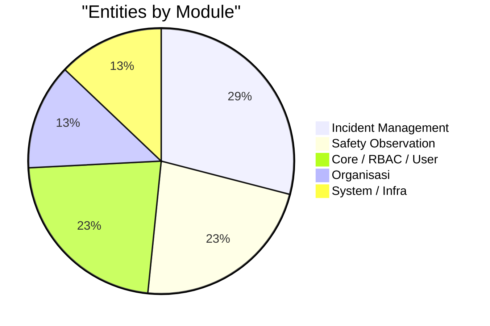

---

## 17. Keamanan

### Security Layers

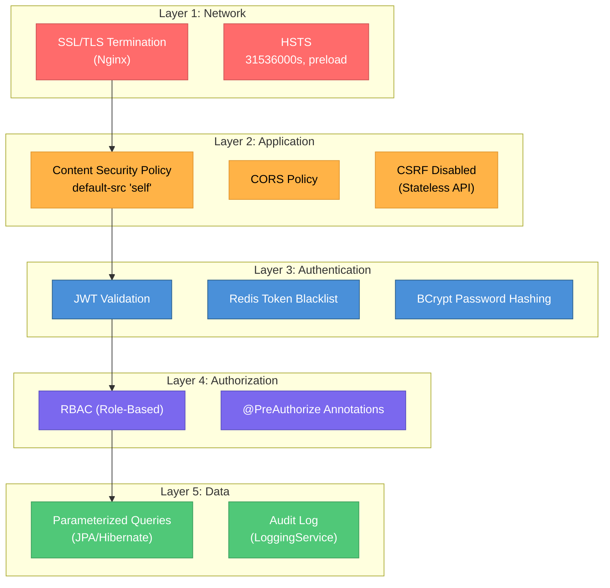

### Security Hardening (systemd)

| Feature | Setting |
|---------|---------|
| Non-root user | `irms` |
| NoNewPrivileges | Yes |
| PrivateTmp | Yes |
| ProtectSystem | Yes (strict) |
| ProtectHome | Yes |

---

## 18. Roadmap & Future Work

### Priority High

| Item | Status | Notes |
|------|--------|-------|
| Mobile app backend integration | Not started | Hubungkan React Native ke IRMS API |
| Expand `@PreAuthorize` ke semua controller | Partial | Hanya sebagian controller yang aktif |
| Unit & integration test coverage | Minimal | Tambah test untuk semua service utama |

### Priority Medium

| Item | Status | Notes |
|------|--------|-------|
| Real-time update via WebSocket | Not started | Untuk status update insiden secara live |
| Dashboard analytics & statistik | Partial | Tambah agregasi data insiden & observasi |
| Rate limiting | Not implemented | Tambah rate limiting pada public endpoints |
| Monitoring & observability | Actuator only | Tambah Prometheus/Grafana |

### Priority Low

| Item | Status | Notes |
|------|--------|-------|
| CI/CD pipeline | Not configured | Tambah GitHub Actions |
| API versioning | v1 only | Rencana migrasi ke v2 |
| Audit log UI | Backend only | Tambah admin panel untuk audit log |

---

## Appendix

### A. Configuration Files

| File | Purpose |
|------|---------|
| `application.yaml` | Main config (dev profile) |
| `application-prod.yaml` | Production overrides |
| `build.gradle` | Gradle build configuration |
| `Dockerfile` | Docker multi-stage build |
| `railway.toml` | Railway PaaS deployment |
| `deploy/nginx/irms.conf` | Nginx reverse proxy config |
| `deploy/apache/irms-proxy.conf` | Apache reverse proxy config |
| `deploy/systemd/` | systemd service configuration |
| `deploy/env/` | Environment template |

### B. SQL Files

Daftar rinci beserta status tiap berkas ada di **[`sql/README.md`](../sql/README.md)** —
itu sumber kebenarannya, jangan duplikasi daftarnya di sini lagi.

Ringkasnya (audit 2026-09-30):

| Kelompok | Keterangan |
|----------|------------|
| Migrasi aktif (PostgreSQL) | `20_app_settings.sql` sampai `29_reopen_jso_2026_open_findings.sql` — ditulis setelah migrasi PG dan menyasar nama tabel yang benar |
| Belum dikonversi (masih MySQL, tabel masih ada) | Skema per-service: `auth_service/`, `irms_service/`, `lims_service/`, `smartdocs_service/`. Ini satu-satunya dokumentasi struktur tabel, jadi jangan dibuang sebelum ada penggantinya |
| Usang (MySQL + tabel sudah tidak ada) | 32 berkas bernomor ≤19 beserta `migration_add_photos.sql`, `seed_observation_categories.sql`, `cleanup_deprecated_permissions.sql` |

Daftar lama di bagian ini sudah tidak akurat: ia menyebut `08_irms_incident_workflow_migration.sql`,
`20_add_division_to_users.sql`, dan `13_lims_import.sql` yang **tidak ada di repo** — dihapus
atau diganti nama tanpa memperbarui dokumen. Itulah alasan daftarnya dipindah ke satu tempat.

### C. Documentation Index

| Document | Description |
|----------|-------------|
| `ARCHITECTURE.md` | Dokumen ini — arsitektur sistem lengkap (menggabungkan bekas `design.md`, `auth_gap_analysis.md`, `flowcharts.md`) |
| `API-DOCUMENTATION.md` | Dokumentasi API dengan contoh request/response |
| `SWAGGER-GUIDE.md` | Panduan penggunaan Swagger UI |
| `REDIS_IMPLEMENTATION.md` | Detail implementasi Redis |
| `../docs/DATABASE_NAMING_CONVENTION.md` | Standar penamaan database & batas data antar microservice (sumber kebenaran, terpisah dari dokumen ini) |

> `design.md`, `auth_gap_analysis.md`, `flowcharts.md`, `project_summary_slides.md`,
> `ssl_lb_tradeoffs.md`, dan `workflow_code_mapping.md` sudah dihapus dari folder ini
> (2026-07-25). Tiga yang terakhir membahas aplikasi lain (procurement/hospital,
> package `id.enterprise_apps` yang tidak pernah ada di repo ini) dan tidak relevan;
> tiga yang pertama isinya sudah dilebur ke sini agar informasi arsitektur tidak
> terpecah di banyak file.

